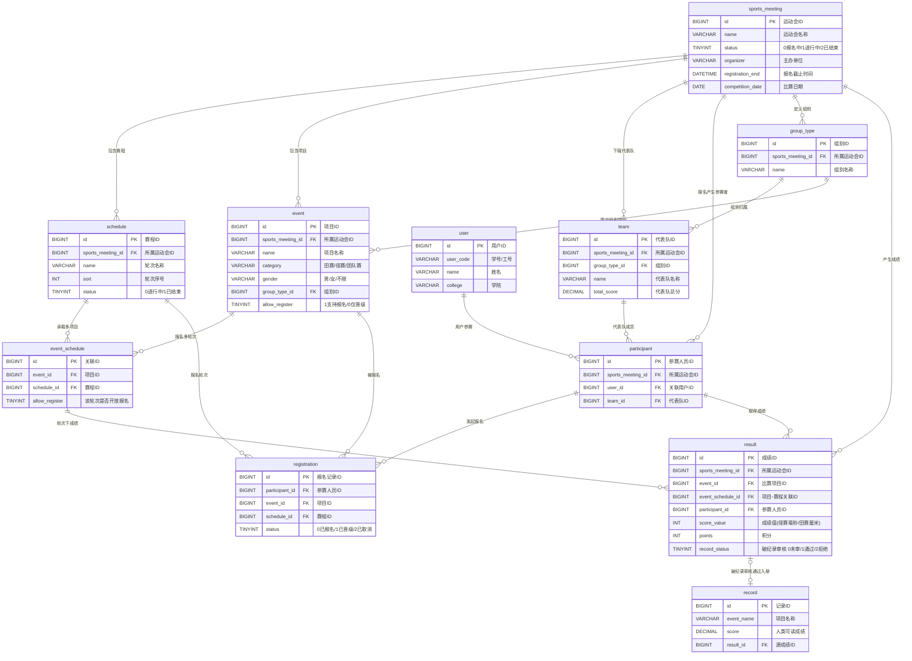

# 数据库 ER 图（核心成绩链路）

> 覆盖：`sports_meeting`、`schedule`、`event`、`event_schedule`、`user`、`team`、`group_type`、`participant`、`registration`、`result`、`record`。
> 所有外键均为**逻辑外键**（无物理 FK 约束），与 `SportBackend/sql/` 下建表脚本一致。审计字段（`create_time`/`update_time`/`is_deleted`）已省略。

